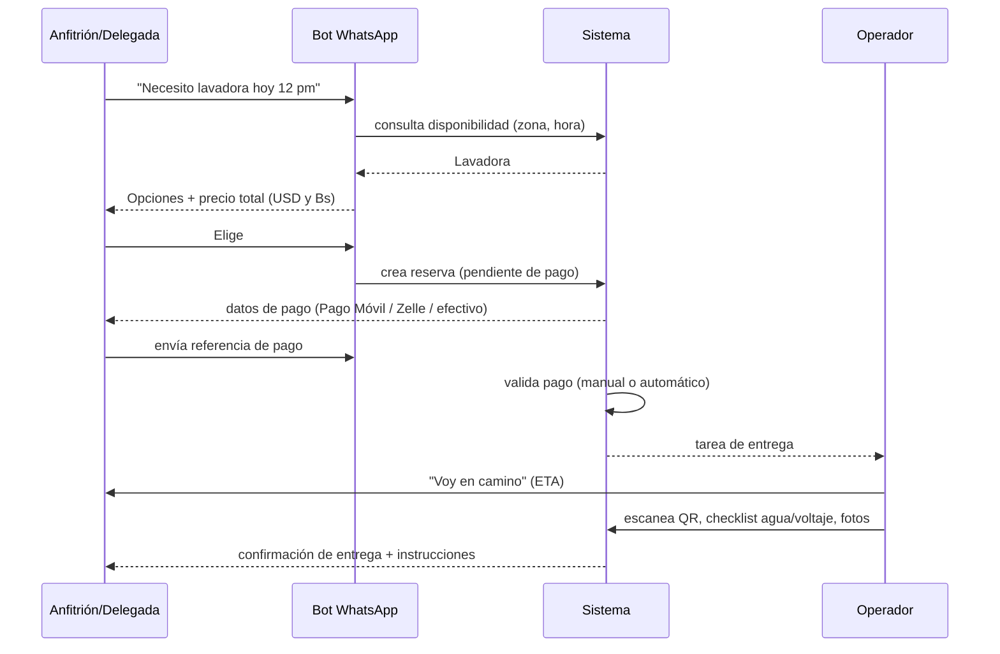
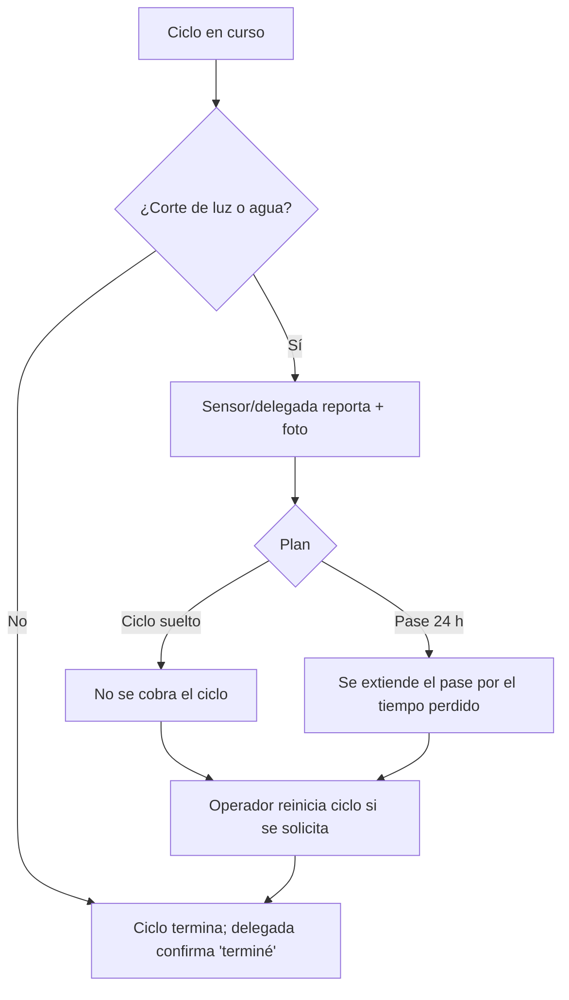
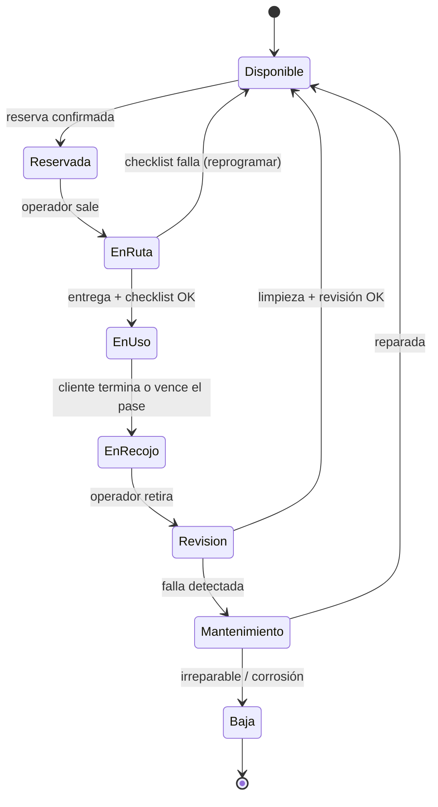
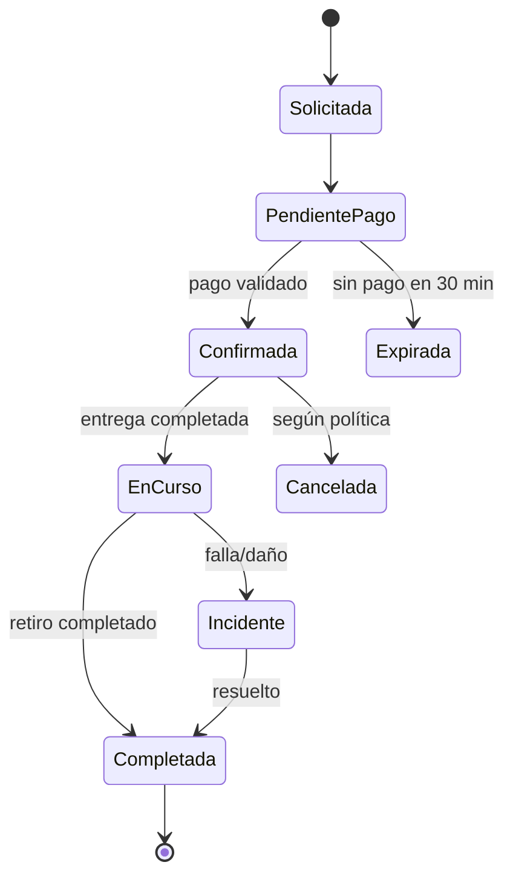
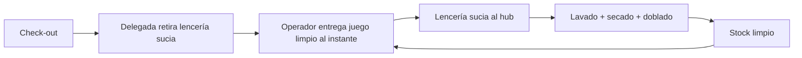

# 08 · Flujos y casos de uso

Los diagramas usan Mermaid (se renderizan en GitHub).

## 1. Casos de uso principales

| ID | Caso de uso | Actor |
|----|-------------|-------|
| CU-01 | Ver catálogo y disponibilidad | Anfitrión, delegado |
| CU-02 | Reservar una lavadora (ciclo / 24 h) | Anfitrión, delegado* |
| CU-03 | Contratar membresía | Anfitrión |
| CU-04 | Entregar e instalar la lavadora | Operador |
| CU-05 | Usar y terminar ("ya terminé") | Delegado |
| CU-06 | Retirar y revisar la lavadora | Operador |
| CU-07 | Reportar falla / corte de luz-agua | Delegado, anfitrión |
| CU-08 | Sincronizar calendario y agendar post check-out | Anfitrión, sistema |
| CU-09 | Pagar y registrar pago | Anfitrión, administrador |
| CU-10 | Mantenimiento programado | Operador, técnico |
| CU-11 | Gestionar flota, precios y reportes | Administrador |

\* El delegado solicita; el anfitrión (o su plan activo) paga.

## 2. Flujo: reservar y entregar

## 3. Flujo: ciclo con corte de luz/agua

## 4. Estados de la lavadora

## 5. Estados de la reserva

## 6. Flujo: sincronización con calendario (iCal)

1. El anfitrión pega el enlace iCal del anuncio (o lo envía por WhatsApp).
2. El sistema lee los check-out de los próximos 30 días (solo fechas; sin datos del huésped).
3. Para cada check-out propone: *"El sábado 11:00 sale tu huésped. ¿Reservo lavadora para 12:00–24 h?"*
4. El anfitrión acepta una vez ("hazlo siempre") o confirma cada vez.
5. Si cambia el calendario, se reprograma o se avisa.

## 7. Flujo de lencería con intercambio (fase 2)

