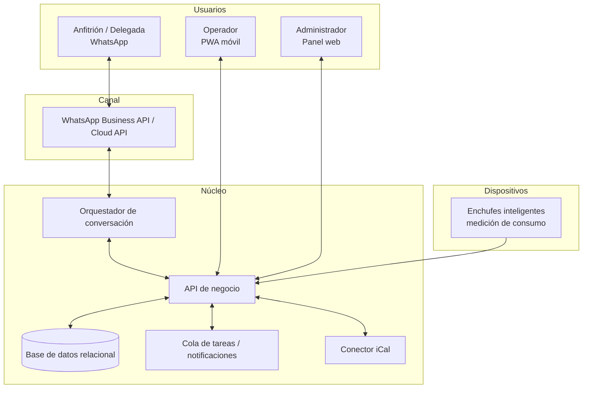
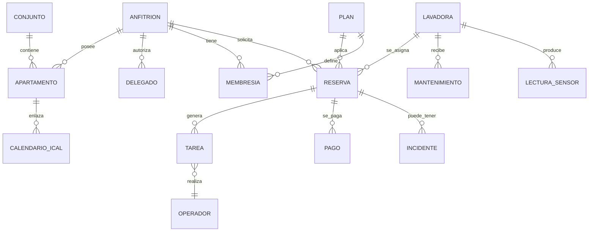

# 09 · Diseño de la solución

> Diseño solamente. **No se construye la web en esta fase.** Esto deja las decisiones listas para cuando se apruebe el desarrollo.

## 1. Principios de diseño

1. **WhatsApp primero**, web/PWA después.
2. **Offline-tolerante**: los operadores y el estado de las máquinas deben sobrevivir a cortes.
3. **El activo físico es el centro**: cada lavadora tiene QR, bitácora y ciclo de vida.
4. **Simple de operar** por un equipo de 1–3 personas.
5. **Transparencia de precio** y evidencia (fotos, registros).
6. **Barato de mantener** (< USD 40/mes en el piloto).

## 2. Arquitectura lógica



### Módulos
| Módulo | Responsabilidad |
|--------|-----------------|
| Catálogo y disponibilidad | Estado de cada lavadora, próxima disponibilidad |
| Reservas | Creación, franjas, políticas, prioridad |
| Despacho | Tareas del operador, ruta, checklists, fotos |
| Flota/activos | QR, ciclos, mantenimiento, bajas |
| Clientes | Anfitriones, delegados, apartamentos, conjuntos |
| Pagos | Registro, conciliación, IGTF informativo, créditos |
| Notificaciones | WhatsApp: confirmaciones, ETA, recordatorios, cobros |
| Calendario | Importa iCal; propone lavados |
| Reportes | Utilización, ingresos, morosidad |
| IoT | Lectura de enchufes, detección de ciclo |

## 3. Stack recomendado (decisión de bajo costo)

| Capa | Opción recomendada | Por qué | Alternativa |
|------|-------------------|---------|-------------|
| Canal | **WhatsApp Cloud API** (Meta) vía proveedor local/regional | Todos lo usan; conversaciones de servicio baratas | Telegram como respaldo |
| Backend + BD | **PostgreSQL** gestionado + API (p. ej., Supabase o similar) | Relacional, auth por teléfono, costo bajo | Firebase |
| App operador | **PWA** instalable, caché offline, sincronización posterior | Sin tienda de apps; funciona con mala señal | App nativa (más cara) |
| Panel admin | Web responsiva | El cliente lo usa desde el teléfono | — |
| IoT | Enchufes inteligentes con medición (Wi-Fi) con API/webhook | Barato; precedente: Bundles | Medidor + lectura manual |
| Hosting | Nube con costo fijo bajo | RNF-07 | — |

> Verificar en la implementación: capacidad de corriente de los enchufes (lavadoras 110 V pueden demandar ~12–15 A; el enchufe debe soportarlo con margen) y disponibilidad de Wi-Fi en cada apartamento (alternativa: sensor en la propia lavadora al regresar, o lectura manual).

## 4. Modelo de datos (conceptual)



### Entidades clave
| Entidad | Campos principales |
|---------|--------------------|
| `conjunto` | id, nombre, zona, reglas de acceso, contacto de junta |
| `apartamento` | id, conjunto_id, torre/piso/unidad, ¿tiene toma de agua/desagüe?, ¿cisterna?, notas de acceso |
| `anfitrion` | id, nombre, teléfono, tipo (residente/remoto), preferencia de pago |
| `delegado` | id, anfitrion_id, nombre, teléfono, PIN, permisos |
| `lavadora` | id, QR, marca/modelo, capacidad kg, fecha de compra, ciclos acumulados, estado, depósito de origen, consumo de agua |
| `plan` | id, tipo, precio_usd, duración, reglas de prioridad |
| `membresia` | id, anfitrion_id, plan_id, inicio, fin, pases restantes |
| `reserva` | id, anfitrion_id, apartamento_id, lavadora_id, plan_id, franja entrega/retiro, estado, precio_usd, tasa_bcv |
| `tarea` | id, reserva_id, tipo (entrega/retiro/mantenimiento), operador_id, checklist (json), fotos, tiempos |
| `pago` | id, reserva_id/membresia_id, moneda, monto, método, referencia, IGTF_aplicado, estado |
| `incidente` | id, reserva_id, tipo (corte luz/agua, falla, daño), evidencias, resolución, crédito |
| `mantenimiento` | id, lavadora_id, tipo, fecha, técnico, costo, notas |
| `lectura_sensor` | id, lavadora_id, timestamp, watts, estado detectado |
| `calendario_ical` | id, apartamento_id, url, última sincronización, preferencia de automatización |

## 5. Catálogo: wireframes de texto (referencia, sin implementar)

### 5.1 Vista de catálogo (WhatsApp / PWA)
```
LAVADORAS — Pescadores 1                 Hoy, sáb 10:20
─────────────────────────────────────────────────────
[#3] 10 kg · Carga frontal              ● DISPONIBLE AHORA
     Pase 24 h: $9  (Bs 000,00)   [Reservar]

[#5] 8 kg  · Carga frontal              ◐ SE LIBERA EN ~40 MIN
     Disponible 11:00                  [Avísame] [Reservar 11:00]

[#2] 10 kg · Carga frontal              ○ RESERVADA 14:00–
     Otra libre mañana 8:00            [Ver mañana]

[#1] 8 kg                               ✖ EN MANTENIMIENTO
─────────────────────────────────────────────────────
¿Tienes feriado? [Reservar temporada]   [Hablar con una persona]
```

### 5.2 Confirmación
```
Resumen
• Lavadora #3 – Pase 24 h
• Entrega: hoy 12:00–12:30 en Torre B, apto 4B
• Incluye: kit (protector de voltaje, mangueras, jabón x2)
• Precio: $9,00  ≈ Bs 000,00 (BCV 00,00)
• Pago Móvil: sin recargo · Efectivo USD: +3% (IGTF)
• Cancelación gratis hasta 2 h antes
[Confirmar]  [Cambiar]
```

### 5.3 Flujo del operador (PWA)
```
TAREAS DE HOY (offline OK)
1) 12:00 ENTREGA #3 → Torre B 4B   [Ir] [Llamar]
   ☐ Agua OK  ☐ Voltaje OK  ☐ Mangueras  ☐ Fotos (3)
   [Escanear QR]  [Completar]
2) 12:45 RETIRO #5 → Torre A 2A
```

### 5.4 Panel del administrador
```
Hoy: 5 entregas · 4 retiros · 1 mantenimiento
Utilización (7 días): 58%     Ingresos mes: $0.000
Cobros pendientes: 2          Alertas: #4 revisión (98 ciclos)
[Flota] [Reservas] [Clientes] [Precios] [Reportes]
```

## 6. IoT: diseño del sensor de estado

- **Lectura:** potencia (W) cada 10–30 s. Estados: apagado (< 5 W), idle/espera (5–20 W), lavando/calentando (> 150 W), centrifugado (picos).
- **Ciclo terminado:** potencia vuelve a idle por > 3 min.
- **"Se libera en ~N min":** modelo simple basado en la duración promedio del programa y el tiempo transcurrido.
- **Offline:** el enchufe guarda eventos y los envía al reconectar; sin Wi-Fi → **confirmación manual** ("terminé") y temporizador del plan.
- **Corte de luz:** pérdida de lecturas + reconexión = posible interrupción → se solicita confirmación y se aplica RN-21.

## 7. Seguridad y privacidad

- Autenticación por teléfono; roles; el delegado no ve pagos.
- Calendarios iCal: solo fechas de check-in/out; sin nombres de huéspedes.
- Fotos de los equipos, no de personas ni interiores privados; protocolo en el checklist.
- Copias de seguridad diarias; registros de auditoría.

## 8. Decisión de construcción por etapas

| Etapa | Qué | Herramientas |
|-------|-----|--------------|
| 0 | Piloto sin software | WhatsApp Business (catálogo), hoja de cálculo, QR en cada máquina |
| 1 | Bot + panel mínimo | WhatsApp Cloud API + BD |
| 2 | PWA operador + IoT | Enchufes y despacho |
| 3 | Catálogo web público + iCal + hub | Web responsiva |
